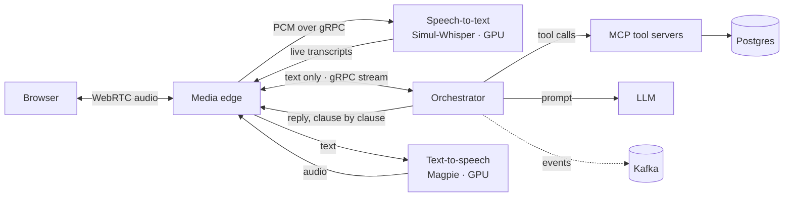

# AI Call Center

**A real-time voice AI agent platform with a streaming data backbone.**
Callers speak to an AI agent in the browser; it understands them, follows each company's business
process, looks up real records, and answers out loud in under two seconds. Every call is recorded
as a stream of events that feeds a lakehouse for analytics and quality monitoring.

Self-hosted speech models on consumer GPUs, gRPC microservices, Kafka, Spark and Delta Lake, built
to run on a small Kubernetes cluster of laptops.

<!-- DIAGRAM: overall system architecture goes here.
     Note: docs/ is gitignored; put images somewhere tracked, e.g. assets/architecture.png -->

---

## Highlights

- **Sub-1.6 s voice replies.** About 1.6 s from the caller's final transcript to the first word
  of the reply. STT, LLM and TTS are streamed and overlapped instead of run one after another.
- **Self-hosted streaming speech-to-text on a 4 GB laptop GPU.** Simul-Whisper serves 2 concurrent
  calls from one shared model, at 197 ms per audio chunk (0.12× real time).
- **The LLM can't skip the process.** Each company's flow is declared in YAML. The orchestrator
  refuses to call a tool until required details (a shipment ID, a phone number) are collected and
  valid, so the model cannot invent a delivery date for a parcel nobody identified.
- **Multi-tenant through config alone.** Three demo companies with different flows, tools and
  languages, including one entirely in French, on the same code.
- **Audio and decisions are separate services.** Audio stays in the media plane; the orchestrator
  only ever sees text. Changing a prompt never redeploys the service carrying live audio.
- **Event-driven data platform.** Calls emit Protobuf events under a Schema Registry that rejects
  incompatible changes. Kafka, Debezium change capture from Postgres, Spark Structured Streaming
  into a Delta Lake, orchestrated by Airflow.
- **Privacy built into the schema.** Each event field declares its personal-data class. The
  lake ingestion job reads those labels to hash identifiers and drop personal fields before
  anything is stored long term.

---

## How a call works

<!-- DIAGRAM: call sequence goes here. The flowchart below can be replaced. -->



1. The browser streams microphone audio over **WebRTC** to the **media edge**, which converts it to
   16 kHz PCM and streams it to **speech-to-text** over a gRPC stream.
2. STT sends partial transcripts back as the caller speaks, and decides when they have stopped.
3. The final transcript goes to the **orchestrator**, which works out the caller's intent and
   where they are in that company's flow.
4. When all required details are collected, it calls the company's **MCP tool server** (for
   example `lookup_shipment`) and gives the result to the **LLM** with guidance for each outcome.
5. The reply is split into clauses as the LLM streams it. Each clause goes to **text-to-speech**
   and is played as soon as it is ready, so the caller hears the first sentence while the rest is
   still being generated.
6. If the caller talks over the agent, playback stops immediately (barge-in).

---

## Architecture

### Voice plane

| Service | What it does | Built with |
| --- | --- | --- |
| [`services/media-edge`](services/media-edge/README.md) | Terminates WebRTC, streams PCM to STT, plays TTS audio back, relays events | Python, aiortc, gRPC |
| [`services/stt`](services/stt/CODE-EXPLAINED.md) | Streaming transcription with voice activity detection, endpointing, partial and final transcripts | Simul-Whisper, PyTorch, CUDA, gRPC |
| TTS | Clause-level speech synthesis | NVIDIA Magpie (NeMo) |
| [`services/orchestrator`](services/orchestrator) | Dialogue engine: intent routing, enforced slot filling, tool calls, LLM turns, barge-in | Python, gRPC |
| [`services/mcp-servers`](services/mcp-servers) | One tool server per company backend | Model Context Protocol |

Services talk over **bidirectional gRPC streams**: one stream per call, so a call's audio stays
pinned to the model instance transcribing it. STT and the orchestrator expose the standard gRPC
health service and drain active calls on shutdown.

### Data platform

| Component | Role |
| --- | --- |
| **Protobuf + Schema Registry** | One versioned event contract ([`events.proto`](data/proto/aicallcenter/events/v1/events.proto)). New versions must stay backward and forward compatible with every previous one. |
| **Kafka (KRaft)** | Call events keyed by call ID, so each call's events stay in order. Separate topics and retention for high-volume partial transcripts. |
| **Postgres + Debezium** | Business records with logical replication; every row change becomes a Kafka event. |
| **Spark Structured Streaming** | Decodes events, redacts personal data using the schema's labels, and writes Delta tables. Runs as a Spark Connect server. |
| **Delta Lake on S3 storage** | Bronze, silver and gold layers on SeaweedFS (S3 API). |
| **Airflow** | Schedules ingestion and data-quality checks. |
| **Grafana** | Dashboards over the analytics tables. |

The data path never blocks a call. Producers send events without waiting, through a bounded
buffer; if Kafka is unavailable, events are dropped and counted, and the call continues.

### Deployment

The target is a 5-node **k3s** cluster connected over Tailscale: three laptops with an RTX 3050,
one laptop without a GPU, and a desktop with an RTX 5070.

- **Voice cells.** Each GPU laptop runs a media edge, STT and TTS together, so call audio never
  crosses the network. STT and TTS share the GPU through time-slicing.
- **LLM.** The desktop hosts the LLM, with a cloud fallback when it is offline.
- **Quorums.** The Kubernetes datastore and Kafka's controllers each run on three laptops, so
  either keeps working with one machine missing.

<!-- DIAGRAM: Kubernetes node layout goes here. -->

---

## Tenants

Companies are YAML files in [`tenants/`](tenants/README.md). The three demo tenants are deliberately
different:

| Tenant | Language | Shows |
| --- | --- | --- |
| **Acme Delivery** | English | An enforced process: no shipment status until a valid 10-character ID is given; malformed IDs are re-asked. Tools: `lookup_shipment`, `reschedule_delivery`. |
| **SwiftNet ISP** | English | A different slot type (a phone number read aloud) and one tool leading to four different conversations depending on the line's status. |
| **Maison Verte** | French | No tools at all: answers from the company's documents, with the whole pipeline in French. |

Each tenant declares its **knowledge** (what the LLM may say), its **process** (required details,
enforced by the orchestrator) and its **tools** (an allowlist). Fixtures include failure cases on
purpose: delayed parcels, area outages, suspended accounts.

---

## Status

| Area | State |
| --- | --- |
| Voice loop: WebRTC → STT → orchestrator → LLM → TTS, end to end | ✅ Working |
| Multi-tenant flows, MCP tool servers, barge-in | ✅ Working |
| Orchestrator Docker image, unit tests and GitLab CI | ✅ In place |
| Event schema, Schema Registry with compatibility enforcement | ✅ Working |
| Kafka, Postgres, Debezium CDC, Spark bronze ingestion into Delta Lake | ✅ Working locally |
| Airflow scheduling, Grafana | 🚧 In progress |
| Services publishing call events to Kafka | 🚧 In progress |
| Streaming metrics with event-time windows, data-quality gates | 📋 Planned |
| Transactional outbox, Postgres read replica, 3-broker Kafka | 📋 Planned |
| Deployment on the k3s cluster | 📋 Planned |

---

## Repository layout

```
services/          Voice plane: media-edge, stt, orchestrator, mcp-servers
tenants/           Tenant configs (YAML), fixtures and knowledge documents
data/              Data platform: event schema, Docker Compose stack, Kafka, Postgres,
                   Debezium, Spark jobs, Airflow DAGs, Grafana
spikes/            Experiments that each answer one question, with measured results
ci/                Shared GitLab CI templates
simul_whisper/     Upstream Simul-Whisper, kept unmodified
                   (patches live in services/stt/app/whisper_compat.py)
reference/         Earlier Azure-based prototype, kept for reference only
```

The [`spikes/`](spikes) folder records how the design was reached. For example,
[`webrtc-audio`](spikes/webrtc-audio/README.md) found a default STUN setting that added 5 s to every
call setup (5137 ms → 141 ms), and [`magpie-tts`](spikes/magpie-tts/README.md) showed that the TTS
model does not stream, which is why replies are synthesised clause by clause.

---

## Getting started

### Requirements

- Linux, Python 3.12, an NVIDIA GPU with at least 4 GB of VRAM and a recent CUDA driver
- Docker with Compose, for the data platform
- A [Groq](https://groq.com) API key for the LLM
- NVIDIA NeMo's `nemo-speech` for TTS, and the Whisper `small` checkpoint in `~/.cache/whisper/`

```bash
python3.12 -m venv .venv
.venv/bin/pip install -r services/stt/requirements.txt
.venv/bin/pip install --index-url https://download.pytorch.org/whl/cu130 \
    torch==2.14.0+cu130 torchaudio==2.11.0+cu130
export GROQ_API_KEY=...
```

### Run the voice loop

Start each in its own terminal, GPU services first:

```bash
# TTS (GPU)
nemo-speech serve --host 127.0.0.1 --port 8083 --no-ui --device cuda \
  --tts-model nvidia/magpie_tts_multilingual_357m \
  --codec-model nvidia/nemo-nano-codec-22khz-1.89kbps-21.5fps

# STT (GPU)
cd services/stt && ../../.venv/bin/python app/server.py --port 50051

# MCP tool servers
cd services/mcp-servers && ../../.venv/bin/python acme_delivery.py     # :9101
cd services/mcp-servers && ../../.venv/bin/python swiftnet_isp.py      # :9102

# Orchestrator
cd services/orchestrator && ../../.venv/bin/python app/server.py       # :50052

# Media edge and web UI
cd services/media-edge && ../../.venv/bin/python server.py             # http://localhost:8082
```

Open **http://localhost:8082**, click *Start mic*, and ask about a parcel, for example shipment
`AC1199Z044`.

### Run the data platform

```bash
docker compose -f data/docker-compose.yml --profile all up -d --wait
data/setup.sh                                             # topics, schemas, bucket, CDC connector
.venv/bin/python data/kafka/smoke.py                      # produce and consume one event
```

| UI | Address |
| --- | --- |
| Kafka UI | http://localhost:8090 |
| Airflow | http://localhost:8095 |
| Grafana | http://localhost:3000 |
| Spark UI | http://localhost:4040 |

---

## Contributing

GitLab is the source of truth; the GitHub repository is a read-only mirror. Branching, commit
style and the merge request process are described in [CONTRIBUTING.md](CONTRIBUTING.md).

## Acknowledgements

- [Simul-Whisper](https://github.com/backspacetg/simul_whisper) for streaming Whisper inference
- [NVIDIA NeMo](https://github.com/NVIDIA/NeMo) for the Magpie TTS model
- [aiortc](https://github.com/aiortc/aiortc) for WebRTC in Python
