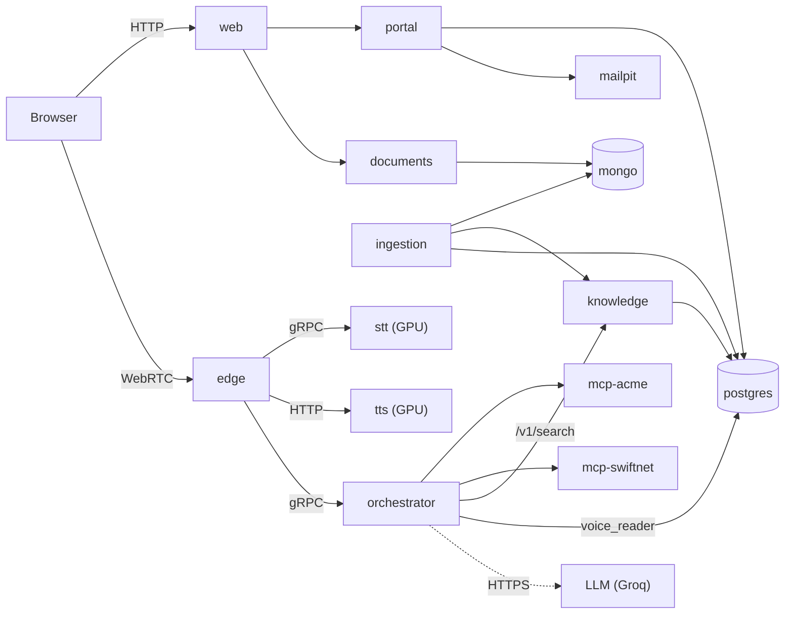

# Core stack: the whole app in containers

One Compose project (`aicc-core`, [`compose.yaml`](compose.yaml)) runs the core app on one
machine: the voice pipeline, the MCP tool servers, the Django platform, RAG, the databases and
the web portal. It is the step before k3s, and it is built so the same images run there
unchanged: containers find each other **only by service name** on one network, and are
configured **only by environment variables**. The data stack (Kafka, Spark, Airflow) is not
part of it; that is [`data/docker-compose.yml`](../data/docker-compose.yml).

```bash
scripts/core-up.sh       # setup (secrets, keys, checks), build, start, wait until healthy
scripts/core-check.sh    # prove every container-to-container call works
scripts/core-down.sh     # stop; data is kept (--volumes deletes it, after asking)
```

| Open | Address |
| --- | --- |
| Portal: sign up, upload documents | http://localhost:8080 |
| Voice test page: pick a client, talk | http://localhost:8082 |
| Mailpit: the emails the portal sends | http://localhost:8025 |
| Postgres, for `psql` while debugging | `127.0.0.1:5434`, database `tenant_portal`, user `portal` |

These four are the only published ports, and only on 127.0.0.1: nothing is reachable from the
LAN.

## Requirements

`scripts/core-setup.sh` (run by `core-up.sh`) checks all of these and prints the fix for
anything missing.

- Linux with Docker and Compose ≥ 2.24. Memory: the limits add up to ~17 GB, but they are
  caps; expect roughly 9 GB in use once warm (an estimate: bge-m3 alone is ~2.3 GB of weights).
  `docker stats --no-stream` shows the real numbers.
- An NVIDIA GPU, driver ≥ 580, and the NVIDIA Container Toolkit (`stt` and `tts` use
  `gpus: all`).
- The models, already on disk. They are mounted read-only and nothing downloads at runtime:
  - `~/.cache/whisper/small.pt` (STT)
  - `~/.cache/nemo-speech/models/nvidia/{magpie_tts_multilingual_357m,nemo-nano-codec-22khz-1.89kbps-21.5fps}` (TTS)
  - `~/.cache/huggingface`, holding `BAAI/bge-m3` (knowledge)
- `GROQ_API_KEY` in the repo's root `.env`. Without it the stack runs, but the agent cannot
  reply.

## Try it

1. `scripts/core-up.sh`. The first build takes a while, and so does the first start: knowledge
   loads bge-m3 and STT warms up the GPU.
2. `scripts/core-check.sh` prints every call between containers, with its result and latency.
3. Open http://localhost:8080 and sign up a company. The verification email is in Mailpit
   (http://localhost:8025). Log in, then upload a PDF, DOCX, XLSX or TXT under Documents.
   `docker compose -f deploy/compose.yaml logs -f ingestion` shows it being chunked and embedded.
4. On the dashboard, **Test your agent** opens the test page on your company. Or open
   http://localhost:8082 and pick it in the client list, next to the three test tenants
   (`acme`, `swiftnet`, `maisonverte`). A company is callable as soon as it exists; nothing
   needs a restart.

## Architecture



| Service | Image (built from) | Port | Talks to | Health check |
| --- | --- | --- | --- | --- |
| `postgres` | `aicc/postgres:dev` (`services/tenant-portal/db/postgres`) | 5432, host 5434 | | `pg_isready` over TCP |
| `db-grants` (job) | `aicc/postgres:dev` | | postgres | exits 0 |
| `mongo` | `aicc/mongo:dev` (`services/documents/db/mongo`) | 27017 | | `mongosh` ping |
| `mongo-setup` (job) | `aicc/mongo:dev` | | mongo | exits 0 |
| `mailpit` | `axllent/mailpit:v1.27` | 1025 SMTP, 8025 UI (host 8025) | | `mailpit readyz` |
| `portal` | `aicc/portal:dev` (`services/tenant-portal`) | 8000 | postgres, mailpit | `/health/live/` (image) |
| `documents` | `aicc/documents:dev` (`services/documents`) | 8000 | mongo | `/health/` (image) |
| `web` | `aicc/web:dev` (`tenant-portal/`) | 8080, host 8080 | portal, documents | `/healthz` |
| `knowledge` | `aicc/ingestion:dev` (`services/ingestion`), `python -m ingestion.api` | 8100 | postgres as voice_reader | `/healthz` |
| `ingestion` | `aicc/ingestion:dev`, the worker | | mongo, postgres, knowledge | none (no port) |
| `mcp-acme` | `aicc/mcp-servers:dev` | 9101 | | TCP |
| `mcp-swiftnet` | `aicc/mcp-servers:dev` | 9102 | | TCP |
| `orchestrator` | `aicc/orchestrator:dev` | 50052 gRPC | mcp-acme, mcp-swiftnet, knowledge, postgres as voice_reader, the LLM | gRPC health |
| `stt` | `aicc/stt:dev`, GPU | 50051 gRPC | | gRPC health |
| `tts` | `aicc/tts:dev`, GPU | 8083 | | `/ready` |
| `edge` | `aicc/media-edge:dev` | 8082 + WebRTC UDP, host 8082 | orchestrator, stt, tts | `/healthz` |

The voice images build from the repo root (their Dockerfiles copy `tenants/`, `libs/`); the
others build from their own folder. `knowledge` and `ingestion` share one image, as do the two
MCP servers.

**Startup order** comes from `depends_on`: postgres → db-grants → knowledge and orchestrator;
mongo → mongo-setup → documents and ingestion; portal and documents → web; orchestrator, stt
and tts → edge. The orchestrator waits for knowledge to *start*, not to be healthy, so the test
tenants are callable before the RAG model has loaded.

**Postgres access.** The portal and the ingestion worker use the owner role. Everything on
the voice side (orchestrator, knowledge) uses `voice_reader`, created by the `db-grants` job
from [`postgres/grants.sql`](postgres/grants.sql) on every start: `SELECT` on
`accounts_tenant (id, name, slug, is_active)` and on `document_chunks`, nothing else.
`core-check.sh` verifies both that it can read those and that it cannot read `accounts_user`.

## Configuration

Services read only environment variables. The non-secret ones (service URLs, ports, flags) are
written in `compose.yaml`. Besides the model caches, the only files mounted in are the tenant
YAMLs (orchestrator), the JWT keys (portal), and the two jobs' scripts.

Secrets live in `deploy/.env`, generated by `scripts/core-setup.sh` (mode 600, gitignored,
never printed). It is plain `KEY=value` lines without quotes, so `docker compose`,
`docker --env-file` and `kubectl create secret --from-env-file` all read it the same way. It is
not a shell script: do not `source` it.

| Name | Used by | What |
| --- | --- | --- |
| `AICC_UID`, `AICC_GID` | tts, portal | your uid/gid: tts runs as you (its model cache is yours); the portal joins your group to read the private key |
| `POSTGRES_DB`, `POSTGRES_USER`, `POSTGRES_PASSWORD` | postgres, db-grants, portal, ingestion | the database owner role |
| `VOICE_READER_PASSWORD` | db-grants, orchestrator, knowledge | the least-privilege role |
| `MONGO_ROOT_USER`, `MONGO_ROOT_PASSWORD` | mongo, mongo-setup | root; no app sees it |
| `MONGO_APP_USER`, `MONGO_APP_PASSWORD` | mongo-setup, documents, ingestion | readWrite on `documents` only |
| `PORTAL_SECRET_KEY`, `DOCUMENTS_SECRET_KEY` | portal, documents | each one's `DJANGO_SECRET_KEY` |
| `MFA_ENCRYPTION_KEY` | portal | base64, 32 bytes |
| `JWT_PUBLIC_KEY` | documents | not secret: `keys/jwt_public.pem` on one line with literal `\n` |
| `keys/jwt_private.pem`, `keys/jwt_public.pem` | portal, mounted at `/keys` | the RS256 pair that signs and verifies JWTs; private key mode 640 |
| `GOOGLE_CLIENT_ID`, `GOOGLE_CLIENT_SECRET` | portal | optional: add them to enable Google sign-in |
| `KNOWLEDGE_MEMORY` | compose | optional: knowledge's memory limit (default `3584m`) |

The orchestrator also loads the repo's root `.env` for `GROQ_API_KEY`, and for `LLM_URL` /
`LLM_MODEL` when the defaults (Groq, `qwen/qwen3.8-27b`) do not suit.

Existing secrets are never replaced: a database volume keeps the password it was created with.
`core-setup.sh --force` makes new ones and moves the old ones to `deploy/.backup/`; the old data
volumes then need those old passwords back, or `core-down.sh --volumes`.

## Things worth knowing

- **WebRTC on a bridge network.** The edge's ICE candidates are its container address, which
  only this machine routes to. A browser on the laptop works; a browser on another machine does
  not. That is what `hostNetwork` is for on k3s (below), or a TURN server.
- **The portal runs its dev settings with `DEBUG=false`.** The prod settings demand HTTPS
  everywhere and this stack is plain HTTP on localhost.
- **`RUN_MIGRATIONS=true` is a no-op on a fresh volume.** The database image's init SQL records
  all 62 migrations of the pinned packages as applied (checked against the code), so `migrate`
  only applies migrations added since. On k3s, migrations become a Job.
- **The databases initialise once.** Postgres and MongoDB run their init scripts only on an
  empty volume. A schema change there needs `core-down.sh --volumes`, or a hand migration.
- **One bge-m3, shared.** knowledge embeds the ingestion worker's chunks and every live search
  with the same 2 CPUs. A large upload can slow searches while it is being embedded.
- **Health checks are the k8s probes** (the Health check column above), and every service has
  a memory limit. `ingestion` has no check: it has no port, and a crash restarts it.

## k3s mapping

The images and the environment variables stay as they are. What changes is the objects around
them.

| Compose | k3s |
| --- | --- |
| a service name (`portal`, `stt`...) | a Service of the same name in one namespace, so every URL in `compose.yaml` still resolves |
| `portal`, `documents`, `web`, `knowledge`, `ingestion`, `mcp-*`, `orchestrator`, `stt`, `tts`, `edge` | Deployments (mailpit only in dev) |
| `postgres`, `mongo` with the `pgdata` / `mongo-data` volumes | StatefulSets with a PVC each (`volumeClaimTemplates`, k3s's `local-path` class) |
| `db-grants`, `mongo-setup` | Jobs run on every deploy (both are idempotent), with `grants.sql` and `mongo-setup.js` in ConfigMaps; plus a Job for the portal's `migrate` + `createcachetable`, with `RUN_MIGRATIONS=false` in its Deployment |
| `deploy/.env` | a Secret: `kubectl create secret generic aicc-core --from-env-file=deploy/.env` |
| `deploy/keys/` mounted on the portal, with `group_add` | a Secret volume at `/keys`, `defaultMode: 0440` and `fsGroup: 10001` |
| the root `.env` (`GROQ_API_KEY`) | a Secret for the orchestrator only |
| `../tenants` mounted on the orchestrator | a ConfigMap at `/srv/aicc/tenants`. Keys cannot contain `/`, so `fixtures/knowledge/` (read by Maison Verte) is a second ConfigMap mounted at that subpath |
| `gpus: all` on `stt` and `tts` | `runtimeClassName: nvidia` (k3s registers it when it finds the NVIDIA runtime), the NVIDIA device plugin with time-slicing so both share one GPU, `nvidia.com/gpu: 1` in limits, and a nodeSelector on the GPU nodes |
| model caches bind-mounted from `~/.cache` | a hostPath or PVC per GPU node, filled by an init container (`nemo-speech pull`, the Whisper download); tts then runs as its own uid 10001 |
| `edge` on the bridge network, port 8082 | `hostNetwork: true` with `dnsPolicy: ClusterFirstWithHostNet`: WebRTC UDP gets the node's real addresses, and Service names still resolve. Browsers allow the mic only on HTTPS (or localhost), so TLS goes in front |
| the `media` volume (documents writes, ingestion reads) | a ReadWriteOnce PVC: documents and ingestion pinned to the same node (affinity) until uploads move to object storage (SeaweedFS S3) |
| `web`: nginx routing paths to portal and documents | Traefik (k3s's ingress) routing the same paths: `/api/auth/`, `/api/tenant/`, `/api/admin/`, `/api/schema/`, `/api/docs/`, `/_allauth/`, `/accounts/`, `/.well-known/`, `/health/` to portal:8000, `/api/documents/` and `/api/session-links/` to documents:8000, the rest to web:8080 |
| `DNS_RESOLVER=127.0.0.11` (Docker's DNS) | if `web` keeps routing: the cluster DNS IP (`kubectl -n kube-system get svc kube-dns`, 10.43.0.10 by default) and fully qualified upstreams (`http://portal.<namespace>.svc.cluster.local:8000`), because nginx's `resolver` ignores the search domains in `resolv.conf` |
| health checks | probes: gRPC probes for orchestrator and stt (native since k8s 1.24), `httpGet` for the HTTP ones, `tcpSocket` for the MCP servers; startup probes for stt, tts and knowledge, which take a minute |
| — | Django probes need `httpHeaders: [{name: Host, value: localhost}]`: the kubelet sends the pod IP as Host, which `ALLOWED_HOSTS` rejects |
| `mem_limit`, `cpus` | `resources.limits` (and `requests`) |
| `stop_grace_period: 30s` | `terminationGracePeriodSeconds: 30` (orchestrator, stt, edge). The orchestrator's `SHUTDOWN_GRACE_S=25` stays below it |
| `cap_drop: [ALL]`, `no-new-privileges` | `securityContext`: `runAsNonRoot`, `allowPrivilegeEscalation: false`, `capabilities.drop: [ALL]` |
| ports published on 127.0.0.1 | the Ingress (web), host networking (edge), `kubectl port-forward` for postgres and mailpit |
| `aicc/*:dev` images | pushed to a registry with immutable tags (the git SHA), or `k3s ctr images import` for a single-node test |

One more thing to plan for: gRPC keeps one long-lived HTTP/2 connection per client, and a
ClusterIP Service balances connections, not requests. With several STT pods, use a headless
Service and client-side round-robin, or every call from one edge lands on the same GPU.
